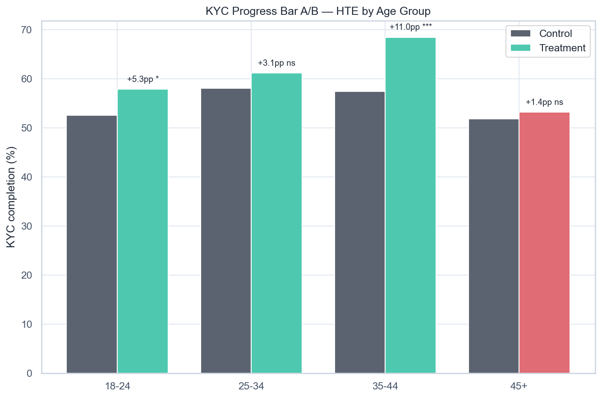

# Volta — 45+ KYC Deep-Dive

[](https://github.com/NikitaBoyarkin/case-kyc-45/actions/workflows/ci.yml)

[](LICENSE)

Age-sliced A/B HTE: 35–44 +11.0pp and 18–24 +5.3pp, but 45+ +1.4pp (ns). Referral (trust) converts 45+ best — friction is trust, not UX.

## Navigation

- 📖 [Full case study on the portfolio site](https://nikitaboyarkin.github.io/en/projects/volta/kyc-45/)
- 🏦 [Parent project: volta-banking](https://github.com/NikitaBoyarkin/volta-banking)
- 🧪 Related cases: [funnel](https://github.com/NikitaBoyarkin/case-funnel) · [referral](https://github.com/NikitaBoyarkin/case-referral)

**On this page:** [Key results](#key-results) · [Situation](#situation) · [Task](#task) · [Actions](#actions) · [Result](#result) · [Recommendations](#recommendations) · [Charts](#charts) · [Dataset](#dataset) · [Quick start](#quick-start)

## Key results

- 35–44 +11.0pp (p<0.001); 45+ +1.4pp (ns)
- 45+ in treatment 53.2% vs 25–34 61.2%
- Referral converts 45+ best (64.1%)

## Situation

The KYC fix lifted conversion overall — but does it close the 45+ segment specifically, which dropped off the funnel the most.

## Task

With the overall lift confirmed, my job was to isolate the senior segment — the one that fell out of the funnel hardest — and see whether the KYC fix closes it too.

## Actions

- Age-sliced A/B HTE of KYC (two-proportion z-test).
- 45+ vs 25–34 KYC completion by channel.
- Chi-square age × completion within treatment.

## Result

- **35–44 +11.0pp** (p<0.001) and **18–24 +5.3pp** (p<0.05) — significant; **45+ +1.4pp** (p=0.59, ns) — the fix does not close 45+.
- The 45+ gap persists in treatment: **53.2% vs 61.2%** for 25–34 (chi² p<0.001).
- **Referral (trust)** converts 45+ best (**64.1%**) with the smallest gap (−2.4pp vs −10.6pp on the website).

## Recommendations

- Don't ship a UX-only fix for 45+ — the barrier is trust.
- Separate track: assisted onboarding (video call / in-branch KYC) + partner/referral channel.
- Test the economics of the trust track (Project 18).

## Charts



## Dataset

The dataset is fully synthetic, generated by seeded, reproducible script(s) (`scripts/generate_ab_data.py`). No real customer data is used. Running `make data` regenerates the CSV(s) in `data/` with the same random seed, so every number below is reproducible.

## Quick start

```bash
uv sync --all-groups
make data
make run
```

## Project structure

```text
case-kyc-45/
├── README.md
├── LICENSE
├── .gitignore
├── .python-version
├── pyproject.toml
├── Makefile
├── .github/workflows/ci.yml
├── scripts/
│   ├── generate_ab_data.py
│   └── volta_kyc_deep_dive.py
├── utils/
│   ├── __init__.py
│   ├── common.py
│   └── viz_helpers.py
├── data/
│   └── volta_ab_experiment.csv
│   └── segment_results.csv
├── outputs/
│   ├── kyc_hte_by_age.png
└── tests/
    └── test_kyc_deep_dive.py
```

## Stack

- Python
- pandas / NumPy
- SciPy / Statsmodels
- scikit-learn
- Matplotlib / Seaborn
- uv + ruff

## Links

- [Full case study on the portfolio site](https://nikitaboyarkin.github.io/en/projects/volta/kyc-45/)
- [Parent project — volta-banking](https://github.com/NikitaBoyarkin/volta-banking)
